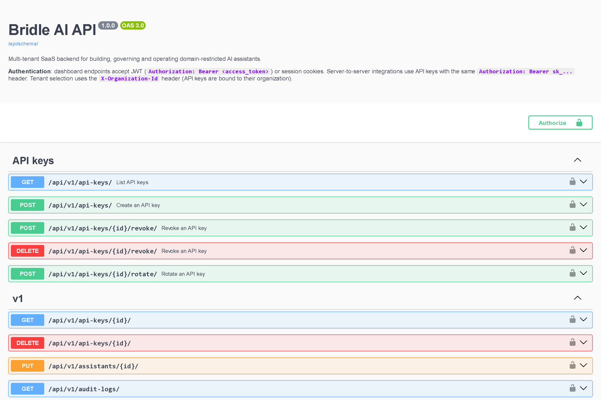
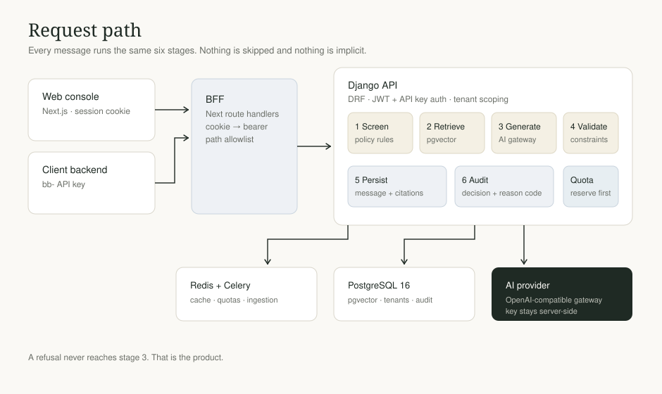

# Bridle AI — API

**The backend that makes an AI assistant answerable.** A multi-tenant Django API that
screens every request against a domain policy, grounds the answer in approved sources,
validates the response, and records the decision.

Companion to [Bridle-Frontend](https://github.com/devpayoub/Bridle-Frontend).



---

## The idea in one sentence

A model will answer anything; Bridle decides whether it **may** answer, and can prove that
decision later.



Every request walks the same path — screen, retrieve, generate, validate, persist, audit.
A refusal never reaches the model, so a blocked request costs nothing and produces a reason
code instead of a guess.

---

## What the API guarantees

| Guarantee | How |
| --- | --- |
| **Tenant isolation** | Every queryset is filtered by organisation in the service layer. A foreign id returns `404`, not `403` — no existence oracle |
| **Policy before spend** | Rules run before generation; quota is reserved before the provider is called |
| **Grounded answers** | Retrieval is limited to the assistant's knowledge bases; citations are stored with the message |
| **Reproducible decisions** | Policy version, evaluator version, reason code, latency and tokens per request |
| **Safe retries** | `Idempotency-Key` on chat; a repeated key returns the original response |
| **Hashed secrets** | API keys are stored as HMAC digests; provider keys are encrypted at rest |

---

## API surface

63 operations under `/api/v1/`, all documented in the generated OpenAPI schema.

| Resource | Endpoints |
| --- | --- |
| **Auth** | register, login, refresh, logout, me, password change/reset, email verification, deactivate |
| **Organizations** | CRUD, members (invite, role change, remove) |
| **Assistants** | CRUD, activate/pause/archive, duplicate, policy, evaluations, usage, AI draft |
| **Knowledge** | knowledge bases, documents, upload, status, reprocess |
| **Chat** | `POST /chat/completions/` — the single call a client backend needs |
| **Conversations** | list, detail, messages, anonymise |
| **Keys** | create, list, retrieve, rotate, revoke, delete |
| **Usage** | summary, by assistant, by key |
| **Audit** | list, detail |
| **Platform admin** | cross-tenant overview, workspaces, accounts, assistants, audit (superusers only) |

Live reference: `/api/docs/` (Swagger UI) · `/api/redoc/` · `/api/schema/`

### One request, end to end

```bash
curl -X POST "$API/api/v1/chat/completions/" \
  -H "Authorization: Bearer bb-..." \
  -H "Idempotency-Key: $(uuidgen)" \
  -H "Content-Type: application/json" \
  -d '{"assistant_id": "<uuid>", "message": "What time is check-in?"}'
```

```json
{
  "decision": "ALLOW",
  "reason_code": "ALLOWED",
  "content": "Check-in starts at 15:00.",
  "citations": [{ "document_title": "Hotel facts", "chunk_index": 0 }],
  "usage": { "input_tokens": 675, "output_tokens": 12 },
  "latency_ms": 3414,
  "request_id": "eb2300239ecc4694963d491d4edd5666"
}
```

A refused request is still a `200` — it is a decision, not an error:

```json
{
  "decision": "REFUSE",
  "reason_code": "PROHIBITED_TOPIC",
  "content": "I can only help with hotel questions.",
  "citations": []
}
```

---

## Architecture

```
apps/
├── accounts/        users, JWT, email verification
├── organizations/   tenancy, memberships, capabilities, workspace AI settings
├── assistants/      assistant configuration, lifecycle, versioning, AI drafting
├── policies/        rule engine, evaluation, policy lab
├── knowledge/       ingestion, chunking, pgvector retrieval
├── conversations/   chat orchestration, history, idempotency
├── ai_gateway/      provider abstraction (OpenAI-compatible + mock), retries, normalised errors
├── api_keys/        bb- keys, scopes, rotation
├── usage/           metering and quotas
├── audit/           append-only event log
├── billing/         plans and entitlements
├── platform_admin/  cross-tenant superuser console API
└── common/          pagination, exceptions, crypto, logging
```

**Stack:** Django 5.2 · DRF · PostgreSQL 16 + pgvector · Redis · Celery · SimpleJWT ·
drf-spectacular · Docker.

---

## Getting started

**Requirements:** Docker Desktop (or Python 3.12 + PostgreSQL 16 with pgvector + Redis).

```bash
git clone https://github.com/devpayoub/Bridle-Backend.git
cd Bridle-Backend
cp .env.example .env
docker compose up --build
```

That starts the API (`:8000`), a Celery worker and beat, PostgreSQL and Redis. Migrations run
on boot.

```bash
# create your first administrator
docker compose exec api python manage.py createsuperuser

# verify the AI provider is wired correctly
docker compose exec api python manage.py ai_check --call
```

- API: <http://localhost:8000/api/v1/>
- Docs: <http://localhost:8000/api/docs/>

### AI provider

The platform is **BYO-key**: point it at any OpenAI-compatible endpoint (OpenAI, a gateway
such as LiteLLM, Azure, vLLM, Ollama) and it works unchanged.

```bash
AI_DEFAULT_PROVIDER=openai
AI_DEFAULT_MODEL_NAME=gpt-4o-mini
OPENAI_API_KEY=...
OPENAI_BASE_URL=          # empty = api.openai.com
```

`ai_check` prints the effective provider, model, base URL, masked key and timeout, and with
`--call` sends one real request — the fastest way to confirm a change took effect.

Leaving `AI_DEFAULT_PROVIDER=mock` runs the whole pipeline offline with deterministic
answers: no key, no bill, and the policy engine still behaves exactly as in production.

---

## Configuration

All configuration is environment-driven. See `.env.example` for the full list.

| Variable | Purpose |
| --- | --- |
| `DJANGO_SECRET_KEY` | Signing and the API-key HMAC pepper |
| `DATABASE_URL` / `REDIS_URL` | PostgreSQL (pgvector) and cache |
| `AI_DEFAULT_PROVIDER`, `AI_DEFAULT_MODEL_NAME` | Defaults for new assistants |
| `OPENAI_API_KEY`, `OPENAI_BASE_URL` | Provider credentials (server-side only) |
| `AI_CREDENTIALS_KEY` | Encrypts per-workspace provider keys |
| `POLICY_*` | Thresholds and fail mode (`closed` by default) |
| `RATE_LIMIT_*` | Per-organisation and per-key limits |

---

## Testing

```bash
docker compose exec api pytest            # API test suite
docker compose exec api python manage.py check
```

`scripts/smoke_chat.py` walks the public API the way a client backend would — log in, create
an assistant, mint a `bb-` key, send a chat request, revoke the key:

```bash
SMOKE_EMAIL=you@example.com SMOKE_PASSWORD='...' python scripts/smoke_chat.py
```

---

## Deployment

`docker-compose.prod.yml` runs the same containers with Gunicorn, no bind mounts and no dev
server. Bring your own PostgreSQL (pgvector required) and Redis; run migrations as a release
step, not on boot.

Health probes: `GET /api/v1/health/` (liveness) and `GET /api/v1/ready/` (dependencies).

---

## License

Proprietary. © Bridle AI. All rights reserved.
